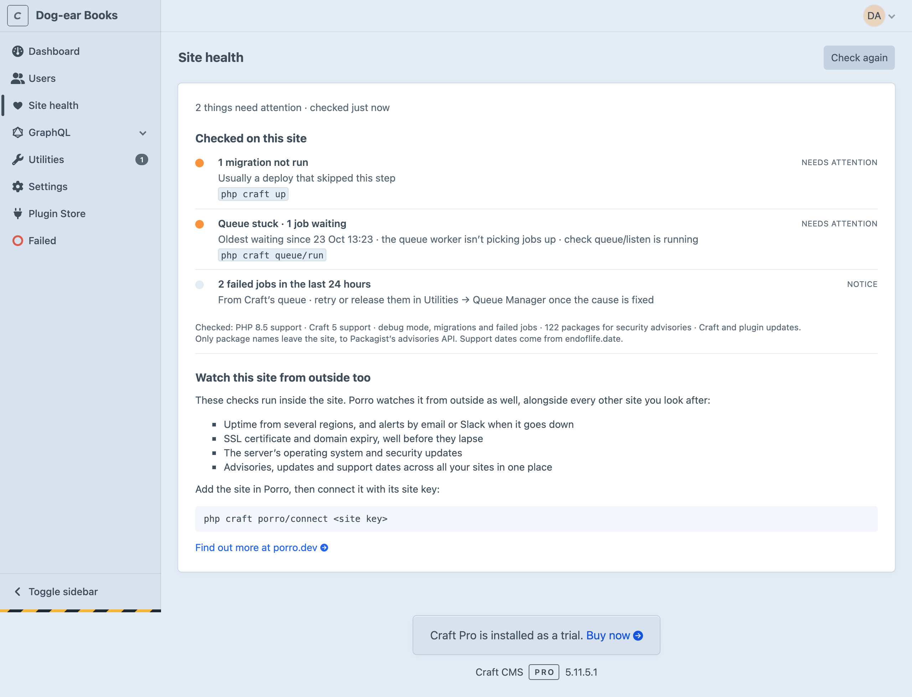
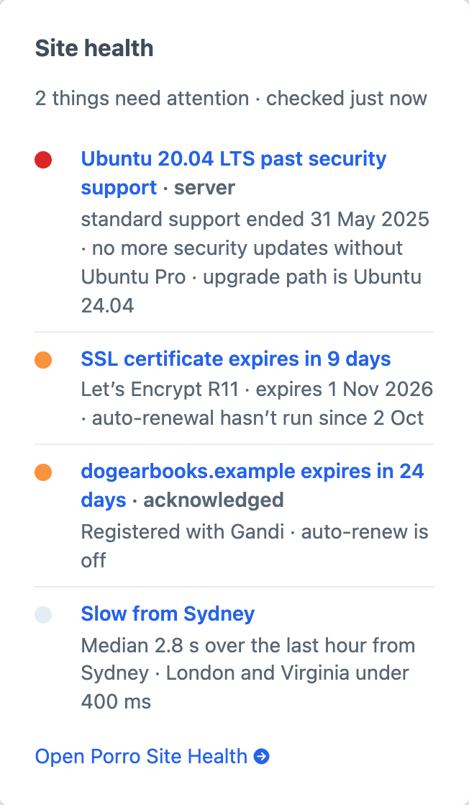
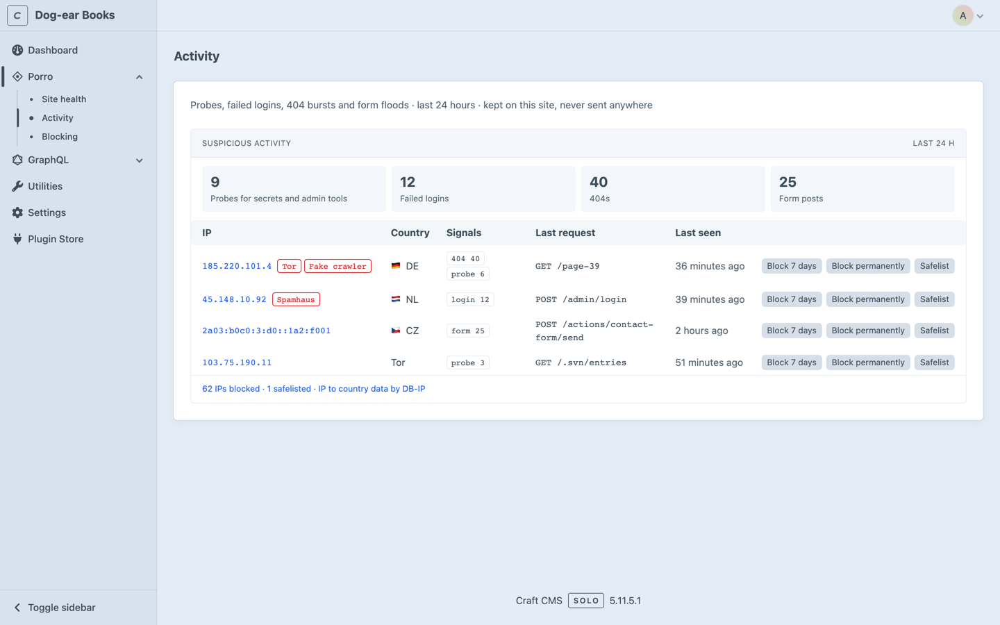
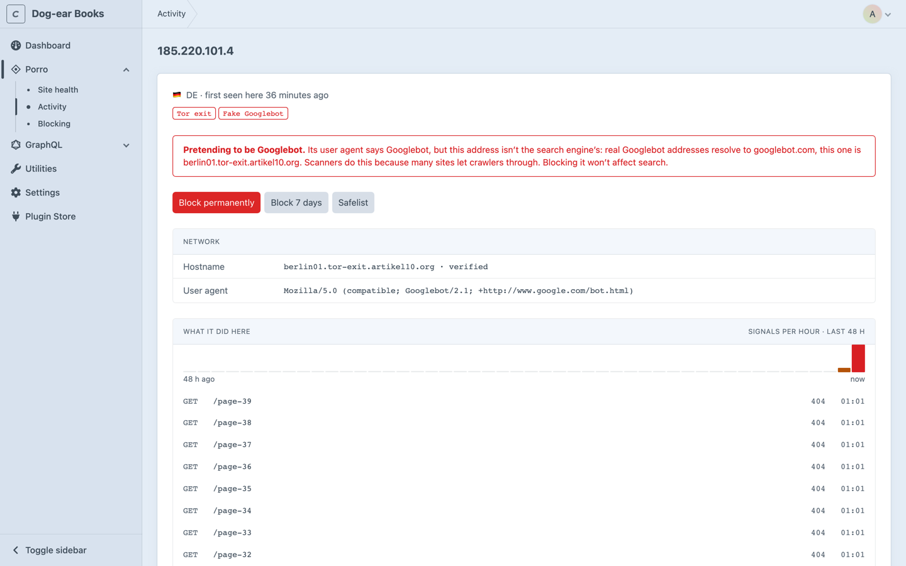
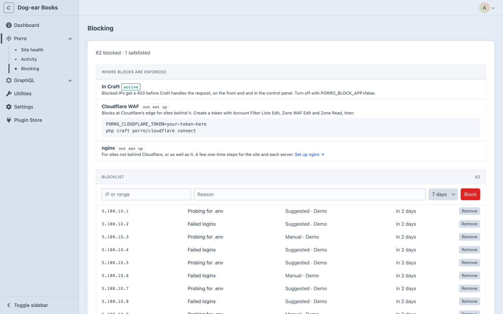
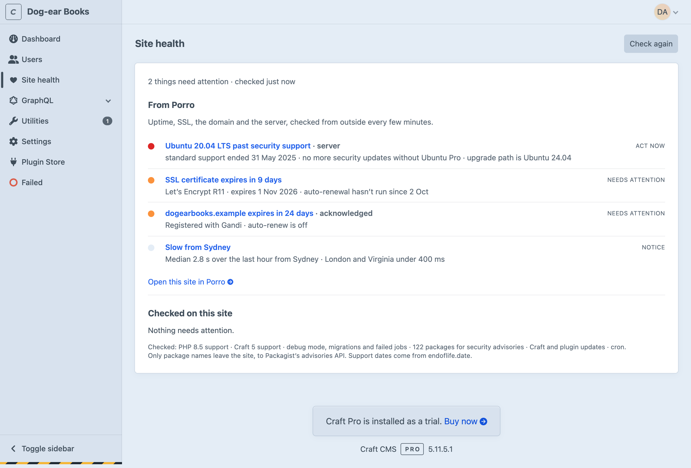

# Porro Site Health for Craft CMS

Site health, suspicious activity and blocking for Craft CMS 4 and 5, inside the control panel. It checks the site for the things that quietly go wrong between projects (security advisories in your Composer packages, PHP and Craft versions running out of security support, Craft and plugin updates, dev mode left on, migrations not run, a stuck queue) and tells you what to do about each. It also spots who's probing the site for secrets, trying passwords or flooding its forms, and lets you block them in a click.

It's free and works on its own. If you use [Porro](https://porro.dev) to look after your sites, connecting it adds what can only be seen from outside: uptime, SSL certificates, domain expiry and the server's operating system.



## Install

From the Plugin Store, or:

```bash
composer require porro/craft-connector
php craft plugin/install porro
```

Then open **Porro** in the control panel nav: **Site health**, **Activity** and **Blocking**. There's a dashboard widget too (New widget → Porro Site Health). It shows the last result rather than running the checks, so the dashboard never waits on them.



### Who can see it

Admins, and users or groups with the **Access Porro** permission (Settings → Users). The pages, the widget and **Check again** all check it. Blocking, unblocking and safelisting also need **Block, unblock and safelist IPs**, under Porro in the same list; without it the Activity and Blocking pages are read-only.

## What it checks

On the site itself, with no account:

| Check | How |
|---|---|
| Security advisories in `composer.lock` | [Packagist's security advisories API](https://packagist.org/apidoc#list-security-advisories), the one `composer audit` uses. Only package names are sent; versions are matched on your server. High and critical advisories show as **Act now**. |
| PHP and Craft support | Past, or within 90 days of, the end of security support, from [endoflife.date](https://endoflife.date). A copy ships with the plugin for when it can't be reached. |
| Updates | Craft and plugin updates from Craft's own update check, flagged when one is critical |
| Dev mode, migrations, the queue | Dev mode on in production, migrations not run (`php craft up`), failed jobs in the last 24 hours, and jobs waiting more than 30 minutes |
| Cron | Once connected: whether cron runs `porro/report`. Without it Porro only hears from the site when someone uses the control panel. |

Results are cached for five minutes, and the public data behind them for between six hours and a day, so the page is quick and the APIs aren't asked often. **Check again** runs everything now.

## Suspicious activity and blocking



**Activity** lists the IPs worth a look from the last 24 hours, worst first: probes for secrets and admin tools (`/.env`, `/.git/config`, `wp-login.php`, `phpmyadmin`…), failed control panel sign-ins, bursts of 404s and form floods. Each IP opens to its details: country, network, a reverse DNS name checked both ways, the Tor exit and Spamhaus DROP lists, and a plain note when something claiming to be Googlebot or Bingbot isn't. What it did here is drawn hour by hour, with its last requests.



From there, or from **Blocking**, an IP or a range can be blocked for 7 days, 30 days or for good. Every block and safelist asks first, saying what will happen to whom. Blocked IPs get a plain 403 before Craft handles the request, on the front end and in the control panel, and can be turned away earlier too:

- **At Cloudflare's edge**, for sites behind Cloudflare: open **Porro → Blocking → Set up Cloudflare** and follow three steps. Create a token with Zone WAF Rules: Edit and Zone: Read on the site's domain, plus Account Rule Lists: Edit on the account. Set it as `PORRO_CLOUDFLARE_TOKEN`, then press Connect (or run `php craft porro/cloudflare connect`). It finds the zone, creates the `porro_blocklist` list and adds one rule next to your existing ones. The list belongs to the whole Cloudflare account, so every site you connect on that account shares its blocks. Changes sync from the queue; only production syncs.
- **In nginx**, before PHP runs: Blocking → Set up nginx walks through it. `PORRO_BLOCK_NGINX=true`, a cron line running `porro/blocklist` every minute on each server, one `include` in the site's nginx config, and a root job that reloads nginx when the file changes and `nginx -t` passes. The page shows how far each server has got.

The blocklist and safelist are tables, so every server of a site shares them, and their own pages search by IP (an IP finds the ranges that cover it), reason or who added it, 50 a page.



Some addresses can never be blocked: Cloudflare, Laravel Forge and its health checks, Google's and Bing's published crawler ranges, and private and reserved ranges. **Always protected** on the Blocking page lists each, with why and where the addresses come from. Blocks that overlap them are refused.

What's recorded stays on the site for 48 hours, in Porro's own `porro_cache` table, so `clear-caches` on deploy doesn't wipe it. Expired rows are cleared hourly; a database backup taken in those 48 hours will include them. Failed sign-in usernames are only kept as a keyed hash. Only production records unless you set `PORRO_ACTIVITY=true`, since a local copy's own traffic is noise; blocks apply everywhere.

**Behind a load balancer or proxy?** Set Craft's [`trustedHosts`](https://craftcms.com/docs/5.x/reference/config/general.html#trustedhosts) to its addresses (or `CRAFT_TRUSTED_HOSTS=10.0.0.5`). Craft's default trusts `X-Forwarded-For` from anyone, which would let a visitor choose their own address, so until `trustedHosts` names your proxies the plugin ignores forwarded headers and uses the address that connected. Behind Cloudflare nothing is needed: Cloudflare's header is believed only when the request really came from Cloudflare.

## Connect Porro (optional)

Porro watches every site you look after from outside: uptime from several regions, SSL and domain expiry, the server's OS and security updates, with alerts by email or Slack. It's a separate service with its own account; see [porro.dev](https://porro.dev) for plans. Nothing in this plugin needs it, and nothing is sent to Porro until you connect. Add the site in Porro and copy its site key, then:

```bash
php craft porro/connect <site key>
```

The Porro Site Health page then shows the site's open findings in Porro alongside the checks above, each linking to Porro.

 Connecting also sends Porro one signed report about the site every 15 minutes. It's read-only: it never changes the site and never accepts commands, and Porro never connects in.

`porro/connect` saves `PORRO_KEY` to `.env` and sends the first report. Reports then go every 15 minutes from cron. `porro/connect` offers to add the line to the server's crontab for you, with the right PHP binary and project folder, and never adds it twice. If it can't, it prints the line to paste into Forge, Ploi or `crontab -e`:

```
*/15 * * * * cd /path/to/site && php craft porro/report --scheduled > /dev/null 2>&1
```

Use `--cron` to add it without asking (handy in provisioning scripts) or `--no-cron` to leave the crontab alone. Skipped it, or connected from another machine? Run `php craft porro/cron` on the server; it needs no key. Add `php craft porro/report --deploy` to your deploy script so Porro hears about deploys straight away.

## Reports

Each report says what sent it, so Porro can tell when cron has stopped:

| Trigger | Sent by |
|---|---|
| `schedule` | Cron, every 15 minutes: the main way reports arrive |
| `deploy` | `php craft porro/report --deploy` in your deploy script. Never fails the deploy |
| `cp` | A backup for a missing cron line: a logged-in control panel visit, when no report has gone in the last 15 minutes |
| `event` | Straight after a plugin is installed, updated or removed, or Craft is updated |
| `connect`, `manual` | `porro/connect`, or running `porro/report` by hand |

Control panel reports are a backup, not a replacement for cron: a quiet site with nobody logging in sends nothing, and Porro still flags a cron line that has stopped. They follow a few rules so the control panel never slows down or breaks because of Porro:

- Never on front-end requests, and never for visitors who aren't logged in.
- Only after the response has gone. On PHP-FPM the page is finished first; elsewhere the report goes through Craft's queue.
- A 3-second timeout, no retries, and every error swallowed.
- One 15-minute throttle shared with cron, deploys and events, kept in Craft's cache. Load-balanced servers sharing a cache send one report between them.

Event reports skip the throttle. When reporting is off (see [Config](#config)), every kind of report is.

## What leaves a site

- Craft version, edition and environment name
- Installed plugins and their versions, and package versions from `composer.lock` (the list is only sent when the lock file changes)
- Whether dev mode is on, as true or false
- Pending migrations, and Craft's queue: whether it runs automatically, jobs waiting, failed jobs, and how long the oldest job has waited
- When cron last ran
- The database engine and version (e.g. MySQL 8.0.36, MariaDB 10.11.6, PostgreSQL 16.4), whether it's on the same server, and the provider if it's a known managed database. Never its host, name, user or password

## What never does

Content, entries, assets, users, settings values or secrets. Run `php craft porro/status --json` to see the exact report your site would send.

## Commands

| Command | Does |
|---|---|
| `porro/connect <key>` | Saves the key, sends the first report and sets up cron (`--cron`, `--no-cron`, `--url`) |
| `porro/cron` | Adds the cron line on its own, no key needed |
| `porro/report` | Sends a report now (`--packages` forces the package list, `--deploy` for deploy scripts) |
| `porro/status` | Shows what the next report contains (`--json` for the raw report) |
| `porro/blocklist` | Tidies the blocklist and, in nginx mode, writes the deny file. Cron runs it every minute in nginx mode |
| `porro/cloudflare [connect\|sync\|status\|disconnect]` | Blocks at Cloudflare's edge |

## Demo

[Dog-ear Books](https://github.com/Porrodev/craft-demo) is a demo site with the plugin set up and things for it to find, a stand-in Porro for the connected view, and the end-to-end checks and screenshot script behind these images.

## External requests

| To | When | What's sent |
|---|---|---|
| `packagist.org` | Advisory check, at most every 6 hours or when `composer.lock` changes | Package names from `composer.lock` |
| `endoflife.date` | Support dates, at most once a day | Nothing beyond the request |
| `app.porro.dev` | Only once connected: reports every 15 minutes, findings when the Porro Site Health page is open (cached 5 minutes) | Signed with the site key |
| Cloudflare, Google, Bing, Forge | Always-protected ranges, at most once a day, from cron or when Activity or Blocking is opened. A copy ships with the plugin. | Nothing beyond the request |
| `check.torproject.org`, `spamhaus.org` | The Tor exit list (hourly at most) and DROP lists (daily), when activity or an IP's details are shown | Nothing beyond the request |
| `download.db-ip.com` | The free country file, monthly, in production | Nothing beyond the request |
| DNS | Reverse and forward lookups when an IP's details are opened | The IP |
| `api.cloudflare.com` | Only with `PORRO_CLOUDFLARE_TOKEN`: connecting, syncing the blocklist after changes and from cron, and an IP's network on its details page | Blocked addresses and their reasons; looked-up IPs |
| `api.abuseipdb.com` | Only when someone clicks **Check on AbuseIPDB**, with `PORRO_ABUSEIPDB_KEY` set | The IP |

Craft's own update check is Craft's, as usual. Requests go through Craft's Guzzle client, so proxy settings apply.

## Config

| Env | Default | |
|---|---|---|
| `PORRO_KEY` | | The site key |
| `PORRO_ENABLED` | unset | `true` or `false` to force reporting on or off |
| `PORRO_ACTIVITY` | production only | Record suspicious activity |
| `PORRO_BLOCK_APP` | `true` | Turn blocked IPs away with a 403 |
| `PORRO_PROTECT_FORGE` | `true` | Keep Laravel Forge's addresses unblockable. Not on Forge? Set `false` |
| `PORRO_PROTECT_CRAWLERS` | `true` | Keep Google's and Bing's crawlers unblockable |
| `PORRO_ABUSEIPDB_KEY` | | Check an IP's reputation on request |
| `PORRO_CLOUDFLARE_TOKEN` | | Block at Cloudflare's edge |
| `PORRO_CLOUDFLARE_HOST` | the primary site's host | Which Cloudflare zone to connect to |
| `PORRO_BLOCK_NGINX` | `false` | Write a deny file for nginx (production only) |
| `PORRO_NGINX_PATH` | `storage/porro/nginx-blocklist.conf` | Where the deny file goes |
| `PORRO_NGINX_REAL_IP` | on behind Cloudflare | Put Cloudflare's real IP lines in the deny file. Set `false` if your nginx config already sets `real_ip_header` |

With `PORRO_ENABLED` unset, only production reports: `CRAFT_ENVIRONMENT` must be `production` (or `prod`, `live`, or unset) and devMode off. A local or staging copy running with the live `.env` stays quiet, so it can't overwrite the live site's state in Porro. Set `PORRO_ENABLED=true` to report from another environment on purpose. `php craft porro/status` shows whether reporting is on and why.

The rest goes in `config/porro.php`:

```php
return [
    // Never blocked or flagged, and can't be removed in the control panel.
    'safelist' => ['203.0.113.7', ['cidr' => '198.51.100.0/24', 'note' => 'Office']],
    // Infrastructure that must always reach the site, on top of the built-in lists.
    'protected' => ['192.0.2.0/24'],
    // Paths the site really serves that look like scanner paths.
    'served' => ['/backup.zip'],
    // When an IP is flagged: probes and failed logins per hour, 404s and form posts per 10 minutes.
    'thresholds' => ['probe' => 3, 'login_failed' => 10, 'not_found' => 60, 'post_flood' => 20],
    // Where the nginx setup page looks for the include, and the reload job's stamp. The defaults suit Forge.
    'nginxConfigDirs' => ['/etc/nginx/sites-enabled', '/etc/nginx/conf.d', '/etc/nginx/forge-conf'],
    'nginxStamp' => '/var/tmp/porro-nginx.stamp',
];
```

## Developing

The tests drive a real Craft install with the plugin installed:

```bash
composer install
CRAFT_PATH=/path/to/craft-site composer test
```

CI builds fresh Craft 4 and Craft 5 sites on Postgres for every push.

## Support

Questions and bugs: [GitHub issues](https://github.com/Porrodev/craft-connector/issues). Security issues: please email security@porro.dev rather than opening an issue. We reply within one working day.

## License

MIT. See [CHANGELOG.md](CHANGELOG.md) for what changed.
