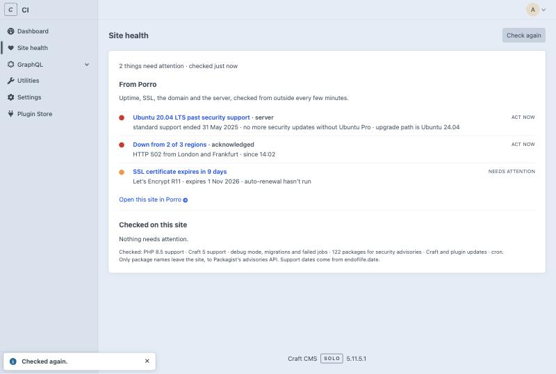

# Porro Site Health for Craft CMS

Site health for Craft CMS 4 and 5, inside the control panel. It checks the site for the things that quietly go wrong between projects (security advisories in your Composer packages, PHP and Craft versions running out of security support, Craft and plugin updates, dev mode left on, migrations not run, a stuck queue) and tells you what to do about each.

It's free and works on its own. If you use [Porro](https://porro.dev) to look after your sites, connecting it adds what can only be seen from outside: uptime, SSL certificates, domain expiry and the server's operating system.



## Install

From the Plugin Store, or:

```bash
composer require porro/craft-connector
php craft plugin/install porro
```

Then open **Site health** in the control panel nav. There's a **Site health** dashboard widget too (New widget → Site health).

### Who can see it

Admins, and users or groups with the **Access Porro** permission (Settings → Users). The page, the widget and **Check again** all check it.

## What it checks

On the site itself, with no account:

| Check | How |
|---|---|
| Security advisories in `composer.lock` | [Packagist's security advisories API](https://packagist.org/apidoc#list-security-advisories), the one `composer audit` uses. Only package names are sent; versions are matched on your server. High and critical advisories show as **Act now**. |
| PHP and Craft support | Past, or within 90 days of, the end of security support, from [endoflife.date](https://endoflife.date). A copy ships with the plugin for when it can't be reached. |
| Updates | Craft and plugin updates from Craft's own update check, flagged when one is critical |
| Dev mode, migrations, the queue | Dev mode on in production, migrations not run (`php craft up`), failed jobs in the last 24 hours, and jobs waiting more than 30 minutes |
| Cron | Once connected: whether cron runs `porro/report`. Without it Porro only hears from the site when someone uses the control panel. |

Results are cached for five minutes, and the public data behind them for between six hours and a day, so the page is quick and the APIs aren't asked often. **Check again** runs everything now.

## Connect Porro (optional)

Porro watches every site you look after from outside: uptime from several regions, SSL and domain expiry, the server's OS and security updates, with alerts by email or Slack. Add the site in Porro and copy its site key, then:

```bash
php craft porro/connect <site key>
```

The Site health page then shows the site's open findings in Porro alongside the checks above, each linking to Porro. Connecting also sends Porro one signed report about the site every 15 minutes. It's read-only: it never changes the site and never accepts commands, and Porro never connects in.

`porro/connect` saves `PORRO_KEY` to `.env` and sends the first report. Reports then go every 15 minutes from cron. `porro/connect` offers to add the line to the server's crontab for you, with the right PHP binary and project folder, and never adds it twice. If it can't, it prints the line to paste into Forge, Ploi or `crontab -e`:

```
*/15 * * * * cd /path/to/site && php craft porro/report --scheduled > /dev/null 2>&1
```

Use `--cron` to add it without asking (handy in provisioning scripts) or `--no-cron` to leave the crontab alone. Skipped it, or connected from another machine? Run `php craft porro/cron` on the server; it needs no key. Add `php craft porro/report --deploy` to your deploy script so Porro hears about deploys straight away.

## Reports

Each report says what sent it, so Porro can tell when cron has stopped:

| Trigger | Sent by |
|---|---|
| `schedule` | Cron, every 15 minutes: the main way reports arrive |
| `deploy` | `php craft porro/report --deploy` in your deploy script. Never fails the deploy |
| `cp` | A backup for a missing cron line: a logged-in control panel visit, when no report has gone in the last 15 minutes |
| `event` | Straight after a plugin is installed, updated or removed, or Craft is updated |
| `connect`, `manual` | `porro/connect`, or running `porro/report` by hand |

Control panel reports are a backup, not a replacement for cron: a quiet site with nobody logging in sends nothing, and Porro still flags a cron line that has stopped. They follow a few rules so the control panel never slows down or breaks because of Porro:

- Never on front-end requests, and never for visitors who aren't logged in.
- Only after the response has gone. On PHP-FPM the page is finished first; elsewhere the report goes through Craft's queue.
- A 3-second timeout, no retries, and every error swallowed.
- One 15-minute throttle shared with cron, deploys and events, kept in Craft's cache. Load-balanced servers sharing a cache send one report between them.

Event reports skip the throttle. `PORRO_ENABLED=false` turns off every kind of report.

## What leaves a site

- Craft version, edition and environment name
- Installed plugins and their versions, and package versions from `composer.lock` (the list is only sent when the lock file changes)
- Whether dev mode is on, as true or false
- Pending migrations, and Craft's queue: whether it runs automatically, jobs waiting, failed jobs, and how long the oldest job has waited
- When cron last ran

## What never does

Content, entries, assets, users, settings values or secrets. Run `php craft porro/status --json` to see the exact report your site would send.

## Commands

| Command | Does |
|---|---|
| `porro/connect <key>` | Saves the key, sends the first report and sets up cron (`--cron`, `--no-cron`, `--url`) |
| `porro/cron` | Adds the cron line on its own, no key needed |
| `porro/report` | Sends a report now (`--packages` forces the package list, `--deploy` for deploy scripts) |
| `porro/status` | Shows what the next report contains (`--json` for the raw report) |

## External requests

| To | When | What's sent |
|---|---|---|
| `packagist.org` | Advisory check, at most every 6 hours or when `composer.lock` changes | Package names from `composer.lock` |
| `endoflife.date` | Support dates, at most once a day | Nothing beyond the request |
| `app.porro.dev` | Only once connected: reports every 15 minutes, findings when the Site health page is open (cached 5 minutes) | Signed with the site key |

Craft's own update check is Craft's, as usual. Requests go through Craft's Guzzle client, so proxy settings apply.

## Config

| Env | Default | |
|---|---|---|
| `PORRO_KEY` | | The site key |
| `PORRO_ENABLED` | `true` | Turn reporting off, e.g. on staging |

## Developing

The tests drive a real Craft install with the plugin installed:

```bash
composer install
CRAFT_PATH=/path/to/craft-site composer test
```

CI builds fresh Craft 4 and Craft 5 sites on Postgres for every push.

## Support

Questions and bugs: [GitHub issues](https://github.com/Porrodev/craft-connector/issues). Security issues: please email security@porro.dev rather than opening an issue. We reply within one working day.

## License

MIT. See [CHANGELOG.md](CHANGELOG.md) for what changed.
